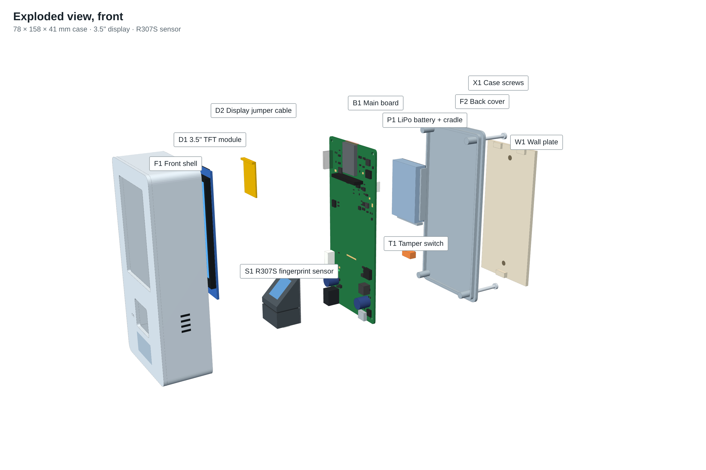
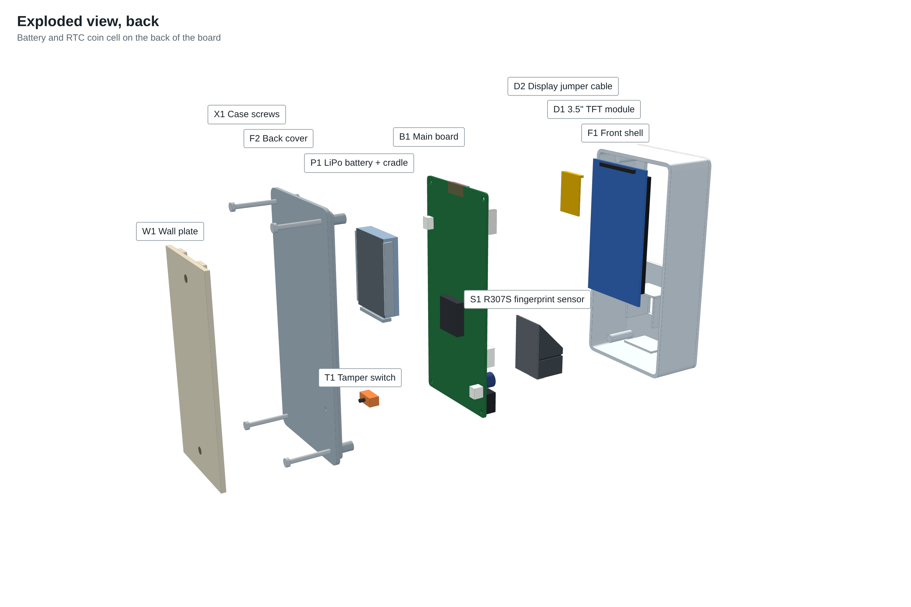
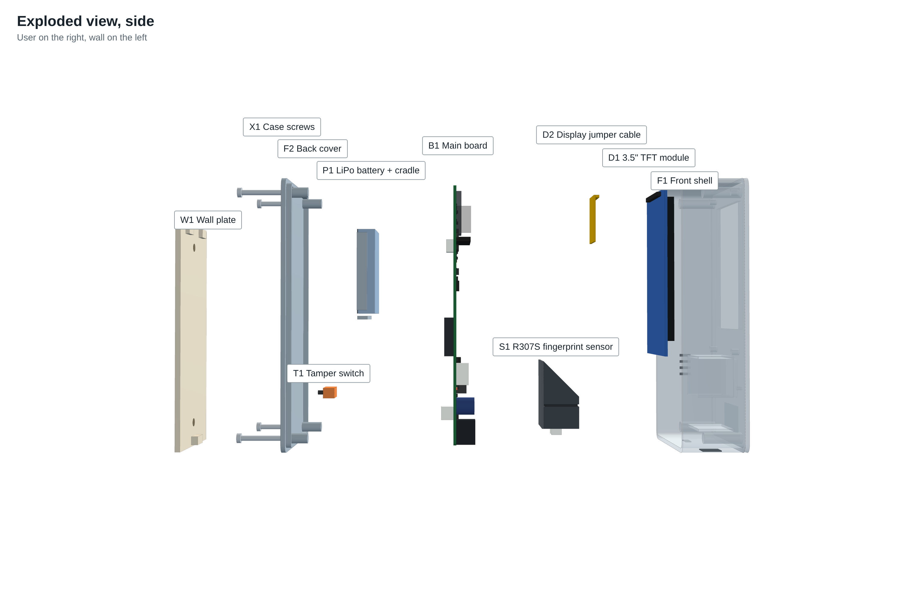
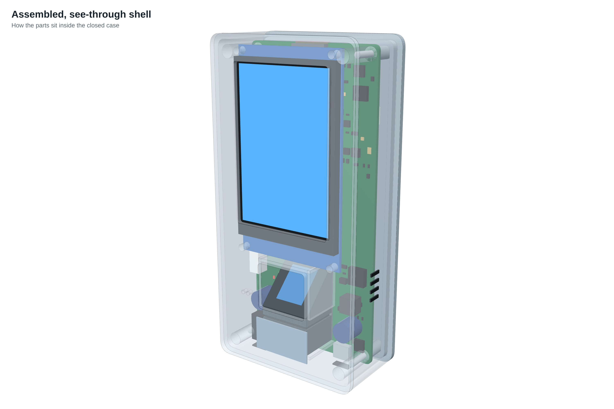
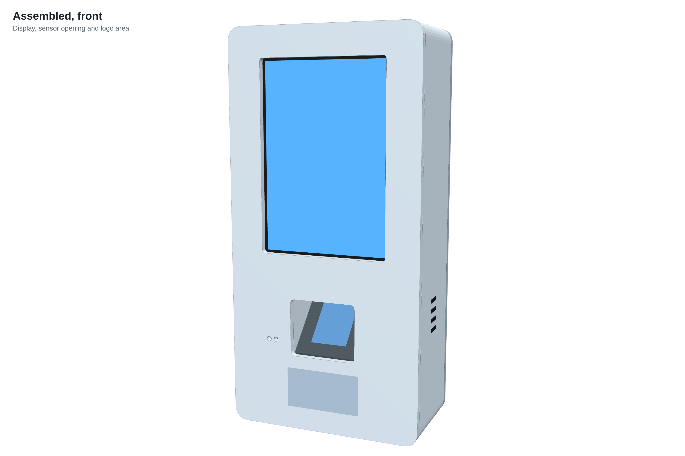

# Enclosure

Interactive 3D exploded view (3.5" ILI9488 layout): [enclosure-exploded.html](enclosure-exploded.html).
Download it and open it in a browser, then drag to rotate and scroll to zoom. It loads three.js from a CDN, so it needs internet access.

Renders:

| | |
|---|---|
|  |  |
|  |  |
|  | |
